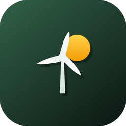

# Gridwalk

**A field toolkit for renewable-energy sites.** 
A site dashboard with NASA POWER sun and wind data, shading and head surveys, meter and wind logs, panel tilt, inspections and over 30 calculators for solar, wind, micro hydro, geothermal, bioenergy and storage, on one Android phone. Works offline once a site's data is fetched.

### ⬇ [Download Gridwalk](https://github.com/zakusworo/gridwalk/releases/latest/download/gridwalk.apk)

Free · no account · no ads · about 10 MB

## Install

1. On your Android phone, open the [download link](https://github.com/zakusworo/gridwalk/releases/latest/download/gridwalk.apk).
2. Open the downloaded `gridwalk.apk`. If Android asks, allow your browser or file manager to **install unknown apps** for this one install.
3. Open **Gridwalk**, type your name (no password, nothing leaves the phone) and allow location when asked.

Needs Android 8.0 or newer on a normal (ARM) phone. To update, install the newer APK over the old one: your data stays.

## Try it with the examples

Open **Settings** (tap your photo or initials, top right) → **Examples** → **Load examples**.

This loads five made-up sites: a rooftop PV system in Bandung (30 kWp on a school roof), a micro hydro river site (about 44 m head, 80 L/s design flow), an island hybrid with wind, solar and storage, a geothermal field and a biogas farm. With them come:

- **Site logs:** meter readings, wind readings and two head surveys along penstock routes.
- **Maps and paperwork:** site layouts, GPS tracks, inspections and daily reports.

Every calculator also has two worked examples: tap **Example 1** or **Example 2** at the top. **Remove examples** takes out only the example records and leaves your own work alone.

## How to use

Every tool has a **?** button in its title bar with step-by-step instructions, and the Logs tab has **How to use Gridwalk**, a handbook of all of them. The same guide is here: **[docs/TUTORIAL.md](docs/TUTORIAL.md)**.

## What's in it

The app has four tabs: **Sites**, **Tools**, **Map** and **Logs**.

### Sites

- **Site dashboard.** Pick a site to see its monthly resource chart, yearly sun and wind numbers, what has been logged there, and the tools for its energy sources.
- **NASA POWER data.** One tap fetches monthly irradiance, temperature and wind for the site's position (needs internet once per site). Tap a bar to read a month, or open the table.
- **Site details.** Energy sources, access, grid connection and notes; each site shows its 12-month curve in the site list.

### Field surveys

- **Shading survey.** Stand where the array will go and trace the skyline with the camera. The sun-path diagram shows which months lose direct sun, and the panel tilt and direction give the monthly and yearly loss.
- **Panel tilt and azimuth.** Lay the phone on a panel or roof to read tilt and the direction it faces.
- **Head survey.** Level down the penstock route leg by leg (angle and slope distance) to get gross head for micro hydro.
- **Wind readings.** Spot anemometer readings with direction; after three readings you get the mean, a Weibull fit, power density and the speed at 30 m.
- **Meter readings.** Cumulative registers for inverters, export meters or generators, with energy per day.

### Calculators

- **Solar PV:** load audit, PV array size, yield estimate (hourly method, any azimuth, horizon shading), string sizing, inverter DC/AC ratio, row spacing, measured vs datasheet, performance ratio.
- **Wind:** speed at hub height, wind power density, turbine energy yield.
- **Micro hydro:** stream flow by float, weir or bucket, hydro power and turbine choice, penstock.
- **Geothermal:** geothermometers, steam tables (IAPWS-IF97), flash steam and brine split, well output from lip pressure (James method), plant output.
- **Storage and bioenergy:** battery bank, charge controller, biogas digester, biogas to power, biomass fuel.
- **Electrical and money:** cable size by voltage drop, PV fuses and breakers, power-current-voltage, payback and LCOE, CO₂ and diesel avoided, energy units.
- **Field:** coordinate converter (lat/lon, UTM, TM-3), distance and bearing, heat stress, lightning distance.

Each calculator shows its formula and assumptions under the result. Steam properties use IAPWS-IF97 regions 1, 2 and 4, checked against the IF97 verification values.

### Logs

- **Inspections.** PV commissioning, small wind, micro hydro, battery room, work at height and electrical isolation (LOTO). A failed critical item gives *Not ready*. Share an inspection as a PDF with signature lines.
- **Daily report** for the visit, shared as a PDF.
- **Map and map library** (DXF, KML, CSV, GeoPDF, offline basemaps) with sites coloured by energy source, **GPS tracks**, **compass**, **sun compass** and a **GPS camera** that stamps position, time and a map QR code on each photo.

## Good to know

- **NASA POWER is satellite and model data** on a grid of roughly 50 km, not a ground station. It is good for a first look and for teaching; a project needs measured data.
- **Wind spot readings are a first look only.** A wind project needs a season or more of mast data.
- **The PV inspection** follows the items IEC 62446-1 asks for; it does not replace the test report the standard requires.
- **Cable sizing** is by voltage drop only. Check ampacity against PUIL or the maker's tables.
- **Phone compass.** Calibrate it (figure 8) and keep away from steel roofs and cars before a shading survey: azimuth errors move the whole skyline.
- **Your data stays on your phone.** There's no account, no server and no tracking. The only online calls are the NASA POWER fetch, the street map and the address on photos.

## Credits

Solar and weather data from the [NASA POWER](https://power.larc.nasa.gov) project (NASA Langley Research Center), funded through the NASA Earth Science Directorate Applied Science Program. Map data © [OpenStreetMap](https://www.openstreetmap.org/copyright) contributors. Built with [MapLibre Native](https://maplibre.org), [ZXing](https://github.com/zxing/zxing) and the [Atkinson Hyperlegible](https://www.brailleinstitute.org/freefont/) typeface (OFL). The example sites and all example records are made up.

Gridwalk is a sister app of [Fieldrig](https://github.com/zakusworo/fieldrig) (mining and geology) and [Wellhand](https://github.com/zakusworo/wellhand) (oil and gas); the three share one core.

Made by [zakusworo](https://github.com/zakusworo). Problems or ideas: [open an issue](https://github.com/zakusworo/gridwalk/issues).
